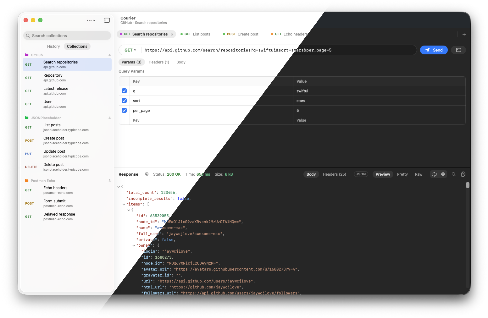

<p align="center">
  
</p>

<h1 align="center">Courier</h1>

<p align="center">
  A native, fast and simple HTTP client for macOS.<br>
  Paste a cURL command, hit <kbd>⌘</kbd><kbd>↩</kbd>, read the response, and save it to a collection.
</p>

<p align="center">
  
</p>

## Why

Courier is a small SwiftUI app for the 90% of API work that doesn't need an account, workspaces or a heavyweight Electron app. It starts instantly, follows the macOS 26 design (light and dark), keeps everything on your Mac, encrypted, and can bring your Postman collections along.

## Features

**Requests**
- **Tabs** for working on several requests at once. They're restored when you reopen the app, and <kbd>⇧</kbd><kbd>⌘</kbd><kbd>T</kbd> reopens tabs you closed.
- **Query params stay in sync with the URL.** Edit either one, and switch individual params and headers on or off.
- **Secrets stay hidden.** Values of headers like `Authorization`, `Cookie`, `X-API-Key` or anything named with "token", "secret" or "key" show as dots until you hover over the value or edit it. You can turn this off in Settings (<kbd>⌘</kbd><kbd>,</kbd>).
- **Body** as JSON (highlighted, with Beautify), plain text, or form fields. Content-Type is set for you unless you set it yourself.

**Collections**
- **Save requests with <kbd>⌘</kbd><kbd>S</kbd>** into named collections. Saved requests are kept until you delete them; they're never trimmed like history.
- A tab opened from a collection stays linked: a dot marks unsaved changes and <kbd>⌘</kbd><kbd>S</kbd> updates the saved request. **Save As…** (<kbd>⇧</kbd><kbd>⌘</kbd><kbd>S</kbd>) makes a copy.
- Give a collection a color; its tabs show a dot in that color.
- Rename, duplicate, delete, copy as cURL, or save any history entry to a collection from the right-click menu.
- **Export and import** collections as JSON files. Secret values (tokens, API keys, cookies, passwords) are left out of exports unless you tick "Include secret values", so files are safe to share by default.
- **Import from Postman** (Collection v2.0/v2.1): folders become "Folder / Request" names, Bearer/Basic/API-key auth becomes headers or parameters, and JSON, form and GraphQL bodies carry over. `{{variables}}` are kept as text.

**cURL**
- **Paste anywhere.** <kbd>⌘</kbd><kbd>V</kbd> with a cURL command on the clipboard opens it in a new tab.
- Understands Chrome/Safari **"Copy as cURL"**, including multi-line commands and `$'…'` quoting.
- Supports `-X`, `-H`, `-d`/`--data-raw`/`--data-binary`, `--data-urlencode`, `--json`, `-u`, `-b`, `-A`, `-e`, `-G`, `-I`, `--url` and `-F`. Options it doesn't use, like `--compressed`, `-k` and `-L`, are ignored.
- **Copy as cURL** turns any request back into a command.

**Responses**
- **Preview, Pretty and Raw** views:
  - JSON opens in a collapsible tree, with right-click to copy any value.
  - HTML is rendered, with JavaScript off.
  - XML and HTML are pretty-printed without rewriting their content.
- **Search** with <kbd>⌘</kbd><kbd>F</kbd> works across every view: highlighted matches and next/previous in text, matches revealed in the JSON tree, and filtering for headers.
- **Redirects are shown, not hidden.** Courier follows them, and a "2 redirects" badge next to the status lists each hop: status, URL, where it pointed, protocol and time.
- **Details on click:** what the status code means, a timing waterfall (DNS, TCP, TLS, time to first byte, download), request and response sizes (compressed and uncompressed), HTTP version, IP addresses, TLS version and cipher, and the server certificate.

**Appearance**
- **Light, Dark or Auto** (follows macOS), in Settings (<kbd>⌘</kbd><kbd>,</kbd>) or View › Appearance.
- Follows the macOS 26 look: Liquid Glass sidebar, text tabs like Apple's own apps, and the open request in the window title.

**History**
- The last 500 requests are kept and can be grouped **by date or by host**, searched, reopened, copied as cURL, saved to a collection or deleted.
- The **History menu** in the menu bar lists your recent requests. Query strings are left out of the menu, since they often carry tokens.
- Tabs, collections and history are **encrypted on disk**, with the key kept in your Keychain.

## Download

Releases are on their way. Once published, get the latest **Courier-x.y.z.dmg** from [Releases](https://github.com/ja1984/courier/releases/latest), open it and drag **Courier** to Applications. A `.zip` of the app and `SHA256SUMS.txt` are attached too. It's signed with a Developer ID and notarized by Apple, so it opens like any other app. It runs on Apple silicon and Intel Macs with macOS 26 or later.

## Requirements

- macOS 26 or later
- Xcode 26 or later (Swift 6.2 toolchain), only needed to build it. The Command Line Tools alone aren't enough: SwiftUI's macros ship only with Xcode.

## Build & install

```bash
git clone https://github.com/ja1984/courier.git && cd courier

swift test                      # run the test suite
./scripts/build-app.sh          # builds build/Courier.app
./scripts/build-app.sh --install  # …and copies it to /Applications
```

`swift run Courier` also works for quick iterations.

If the build fails with `plugin for module 'SwiftUIMacros' not found`, Swift is using the Command Line Tools instead of Xcode. Point it at Xcode:

```bash
sudo xcode-select -s /Applications/Xcode.app/Contents/Developer
# or, for a single command:
DEVELOPER_DIR=/Applications/Xcode.app/Contents/Developer swift test
```

The build script signs the app with your Apple Development certificate if you have one, or with `CODESIGN_IDENTITY` if set. Without one it falls back to ad-hoc signing, and macOS will then ask for Keychain access after each rebuild, because ad-hoc signatures change every build.

## Keyboard shortcuts

| Action | Shortcut |
|---|---|
| Send request | <kbd>⌘</kbd><kbd>↩</kbd> |
| Cancel request | <kbd>⌘</kbd><kbd>.</kbd> |
| New tab / close tab | <kbd>⌘</kbd><kbd>T</kbd> / <kbd>⌘</kbd><kbd>W</kbd> (or middle-click a tab) |
| Reopen closed tab | <kbd>⇧</kbd><kbd>⌘</kbd><kbd>T</kbd> |
| Settings | <kbd>⌘</kbd><kbd>,</kbd> |
| Next / previous tab | <kbd>⇧</kbd><kbd>⌘</kbd><kbd>]</kbd> / <kbd>⇧</kbd><kbd>⌘</kbd><kbd>[</kbd> |
| Import cURL from clipboard | <kbd>⌘</kbd><kbd>V</kbd> anywhere, or <kbd>⇧</kbd><kbd>⌘</kbd><kbd>V</kbd> |
| Save / Save As | <kbd>⌘</kbd><kbd>S</kbd> / <kbd>⇧</kbd><kbd>⌘</kbd><kbd>S</kbd> |
| Copy as cURL | <kbd>⇧</kbd><kbd>⌘</kbd><kbd>C</kbd> |
| Find in response | <kbd>⌘</kbd><kbd>F</kbd>, then <kbd>⌘</kbd><kbd>G</kbd> / <kbd>⇧</kbd><kbd>⌘</kbd><kbd>G</kbd> |

## Data & privacy

- **Tabs, collections and history** (the last 500 requests, including headers) are stored **encrypted** in `~/Library/Application Support/Courier/`:
  - The encryption is AES-256-GCM. The key is generated once and kept in your login Keychain.
  - Files from older versions are encrypted and their plain-text copies deleted on first launch.
  - If the key can't be read, Courier tells you and doesn't save that session; it never falls back to plain text.
  - A file that can't be opened is renamed (`*.unreadable-<timestamp>`) instead of being overwritten.
  - The data files alone are unreadable. The key isn't synced via iCloud, but like your other saved passwords it is included when you back up or migrate your whole user account, so a restored account can still open them.
- **Hidden header values are only hidden on screen.** They're still sent, saved (encrypted) in history, and included in Copy as cURL.
- **Closed tabs** can be reopened until you quit. They aren't saved to disk.
- **No cookies or cache between requests.** Each request uses a fresh connection, which is also what makes the full DNS/TCP/TLS timing available every time.
- **Exported collection files are plain JSON**, not encrypted. By default they don't contain secret values.
- **HTML previews** run without JavaScript and with no persistent storage. Links open in your browser.
- **Other data folders:** set `COURIER_DATA_DIR=/some/folder` to run against another folder, handy for demos (the screenshot above was made that way).

## Releasing

Push a version tag and GitHub Actions tests, builds a universal Courier.app, signs and notarizes it and its disk image, and publishes both as a release:

```bash
git tag v1.1.0 && git push origin v1.1.0
```

The tag sets the version shown in About Courier, and the release notes list the commit titles since the previous tag (edit them on GitHub afterwards if needed).

Running the **Release** workflow by hand from the Actions tab builds the zip as a workflow artifact without publishing a release. Releases are signed with a Developer ID and notarized, using the five repository secrets listed at the top of [`release.yml`](.github/workflows/release.yml). Tagged builds fail without them rather than publish an unsigned app.

## Project layout

```
Sources/
  CourierCore/   Parsing, formatting, networking and storage: cURL parser/exporter, JSON tree,
                 XML/HTML formatter, HTTP client with metrics, collections, encrypted file store.
                 No UI; fully unit tested.
  Courier/       The SwiftUI app: state, Keychain-backed persistence and views.
Tests/
  CourierCoreTests/   Swift Testing suite (`swift test`)
Resources/       Info.plist and the icon master (AppIcon.png)
scripts/         build-app.sh (bundle + install), make-dmg.sh, notarize.sh, release-notes.sh, make-icon.sh
.github/         Release workflow
```

## Known limitations

- `-F` multipart fields are imported as URL-encoded form fields, so file uploads aren't supported yet.
- No environments/variables yet, and collections can't be nested or reordered yet.
- Postman import: file uploads in form-data, and auth types other than Bearer, Basic and API key, aren't carried over (the import tells you).
- Over HTTP/2 and HTTP/3, header sizes are the compressed on-the-wire bytes, so they're approximate.
- Redirects are always followed. Each hop is listed, but the network and timing details describe the final response.
- The JSON tree is limited to 128 levels of nesting. Deeper documents open in Pretty view instead.

## Built with AI, free of AI

Courier was written with the help of an AI coding assistant ([Claude Code](https://claude.com/claude-code)); commits made that way say so in their `Co-Authored-By` line.

The app itself contains no AI. It has no AI features, it doesn't talk to any AI service, and it has no analytics or telemetry. It only connects to the servers you send requests to, plus, in HTML Preview, whatever images and stylesheets that page loads, just like a browser would.

## License

MIT. See [LICENSE](LICENSE).
