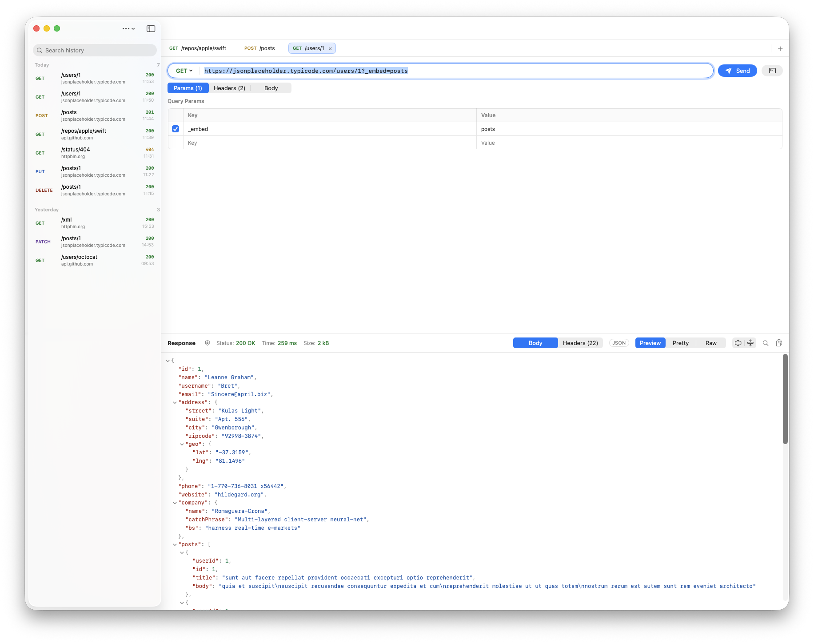

<p align="center">
  
</p>

<h1 align="center">Courier</h1>

<p align="center">
  A native, fast and simple HTTP client for macOS.<br>
  Paste a cURL command, hit <kbd>⌘</kbd><kbd>↩</kbd>, and read the response.
</p>

<p align="center">
  
</p>

## Why

Courier is a small SwiftUI app for the 90% of API work that doesn't need an account, workspaces or a heavyweight Electron app. It starts instantly, follows the macOS 26 design, and keeps everything on your Mac.

## Features

**Requests**
- **Tabs** for working on several requests at once. They're restored when you reopen the app.
- **Query params stay in sync with the URL.** Edit either one, and switch individual params and headers on or off.
- **Body** as JSON (highlighted, with Beautify), plain text, or form fields. Content-Type is set for you unless you set it yourself.

**cURL**
- **Paste anywhere.** <kbd>⌘</kbd><kbd>V</kbd> with a cURL command on the clipboard opens it in a new tab.
- Understands Chrome/Safari **"Copy as cURL"**, including multi-line commands and `$'…'` quoting.
- Supports `-X`, `-H`, `-d`/`--data-raw`/`--data-binary`, `--data-urlencode`, `--json`, `-u`, `-b`, `-A`, `-e`, `-G`, `-I`, `--url` and `-F`. Options it doesn't use, like `--compressed`, `-k` and `-L`, are ignored.
- **Copy as cURL** turns any request back into a command.

**Responses**
- **Preview, Pretty and Raw** views:
  - JSON opens in a collapsible tree, with right-click to copy any value.
  - HTML is rendered, with JavaScript off.
  - XML and HTML are pretty-printed without rewriting their content.
- **Search** with <kbd>⌘</kbd><kbd>F</kbd> works across every view: highlighted matches and next/previous in text, matches revealed in the JSON tree, and filtering for headers.
- **Details on click:** what the status code means, a timing waterfall (DNS, TCP, TLS, time to first byte, download), request and response sizes (compressed and uncompressed), HTTP version, IP addresses, TLS version and cipher, and the server certificate.

**History**
- Every request is saved and can be grouped **by date or by host**, searched, reopened, copied as cURL or deleted.

## Requirements

- macOS 26 or later
- Xcode 26 or later (Swift 6.2 toolchain), only needed to build it

## Build & install

```bash
git clone https://github.com/ja1984/courier.git && cd courier

swift test                      # run the test suite
./scripts/build-app.sh          # builds build/Courier.app
./scripts/build-app.sh --install  # …and copies it to /Applications
```

`swift run Courier` also works for quick iterations. The `.app` bundle is ad-hoc signed for local use.

## Keyboard shortcuts

| Action | Shortcut |
|---|---|
| Send request | <kbd>⌘</kbd><kbd>↩</kbd> |
| Cancel request | <kbd>⌘</kbd><kbd>.</kbd> |
| New tab / close tab | <kbd>⌘</kbd><kbd>T</kbd> / <kbd>⌘</kbd><kbd>W</kbd> (or middle-click a tab) |
| Next / previous tab | <kbd>⇧</kbd><kbd>⌘</kbd><kbd>]</kbd> / <kbd>⇧</kbd><kbd>⌘</kbd><kbd>[</kbd> |
| Import cURL from clipboard | <kbd>⌘</kbd><kbd>V</kbd> anywhere, or <kbd>⇧</kbd><kbd>⌘</kbd><kbd>V</kbd> |
| Copy as cURL | <kbd>⇧</kbd><kbd>⌘</kbd><kbd>C</kbd> |
| Find in response | <kbd>⌘</kbd><kbd>F</kbd>, then <kbd>⌘</kbd><kbd>G</kbd> / <kbd>⇧</kbd><kbd>⌘</kbd><kbd>G</kbd> |

## Data & privacy

- **Tabs and history** (the last 500 requests) are saved as JSON in `~/Library/Application Support/Courier/`. They're stored **in plain text, including headers**, so cookies and tokens from pasted cURL commands end up on disk. Delete history entries you don't want kept.
- **No cookies or cache between requests.** Each request uses a fresh connection, which is also what makes the full DNS/TCP/TLS timing available every time.
- **HTML previews** run without JavaScript and with no persistent storage. Links open in your browser.
- **Other data folders:** set `COURIER_DATA_DIR=/some/folder` to run against another folder, handy for demos (the screenshot above was made that way).

## Project layout

```
Sources/
  CourierCore/   Parsing, formatting and networking: cURL parser/exporter, JSON tree,
                 XML/HTML formatter, HTTP client with metrics. No UI; fully unit tested.
  Courier/       The SwiftUI app: state, persistence and views.
Tests/
  CourierCoreTests/   Swift Testing suite (`swift test`)
Resources/       Info.plist and the icon master (AppIcon.png)
scripts/         build-app.sh (bundle + install), make-icon.sh
```

## Known limitations

- `-F` multipart fields are imported as URL-encoded form fields, so file uploads aren't supported yet.
- No environments/variables or saved collections yet.
- Over HTTP/2 and HTTP/3, header sizes are the compressed on-the-wire bytes, so they're approximate.
- After redirects, the network and timing details describe the final hop.
- The JSON tree is limited to 128 levels of nesting. Deeper documents open in Pretty view instead.

## License

MIT. See [LICENSE](LICENSE).
